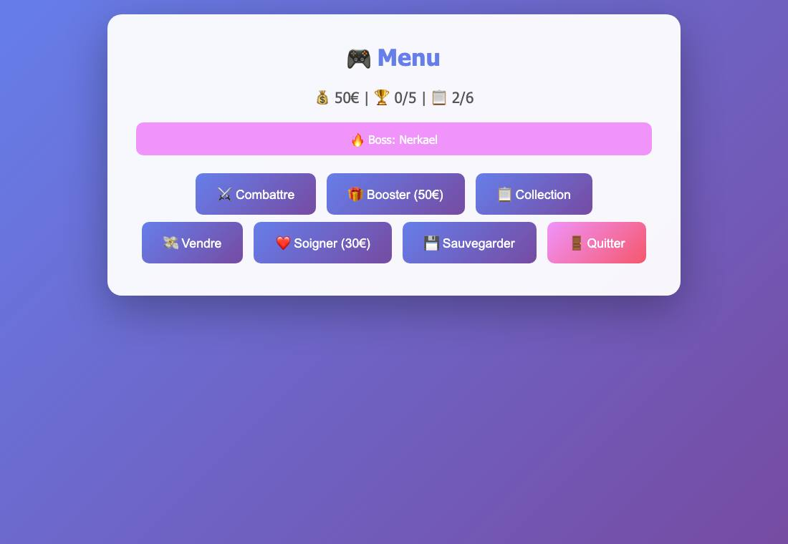
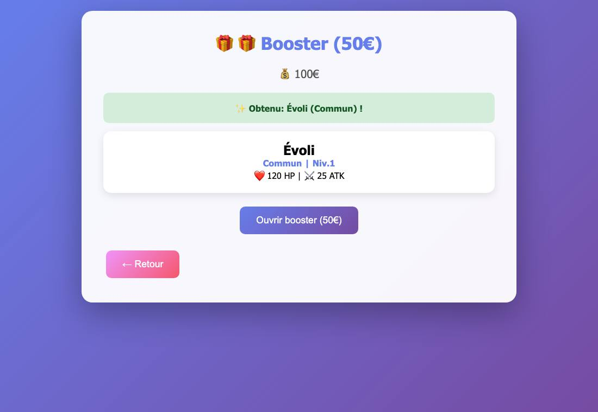
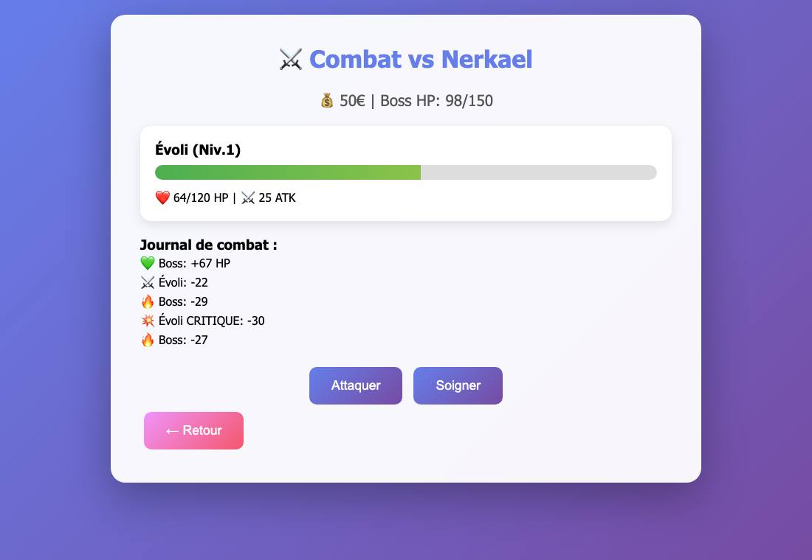

# Pokémon Game 2.0

> C'est l'un de mes tout premiers jeux ! Cette version 2.0 corrige les bugs de la [première version](https://github.com/Alex12062012/Pokemon-Game).

Un petit jeu web de collection et de combats inspiré de Pokémon : on ouvre des boosters pour former une équipe, puis on affronte 5 boss de plus en plus forts.

| Menu | Booster | Combat |
|---|---|---|
|  |  |  |

## Comment jouer

- **Boosters (50 €)** : un Pokémon au hasard. Commun 50 %, Rare 20 %, Épique 20 %, Dracaufeu 8 %, Mew 2 %.
- **Combats** : choisis un Pokémon, puis *Attaquer* (15 % de coups critiques) ou *Soigner* (+45 % des PV). Le boss peut aussi se soigner.
- **Victoire** : la récompense du boss et de l'XP. À chaque niveau, le Pokémon gagne +3 ATK et +10 PV.
- **Défaite** : +25 € de consolation. Il faut soigner l'équipe (30 €) avant de recombattre.
- Équipe de 6 Pokémon maximum. On peut revendre les Pokémon (40 à 800 € selon la rareté).
- Comptes joueurs et sauvegardes, interface en français, anglais et russe.

## Lancer le jeu

```bash
pip install -r requirements.txt
python app.py
```

Ouvre ensuite http://localhost:5000.

## Technique

- **Langage et serveur :** Python avec [Flask]. Tout le jeu tient dans `app.py`, pages HTML comprises.
- **Données :** les comptes sont dans `pokemon_users.json`, avec des mots de passe hachés (SHA-256). Les parties sont dans `pokemon_saves/`.
- **Déploiement :** `gunicorn app:app` fonctionne pour une mise en ligne.
- **Origine du code :** il a été écrit avec l'aide de l'assistant IA Qwen, d'où le nom d'origine du fichier.

[Flask]: https://flask.palletsprojects.com

---
*Projet de fan, non officiel. Pokémon est une marque de Nintendo / Creatures / Game Freak.*
